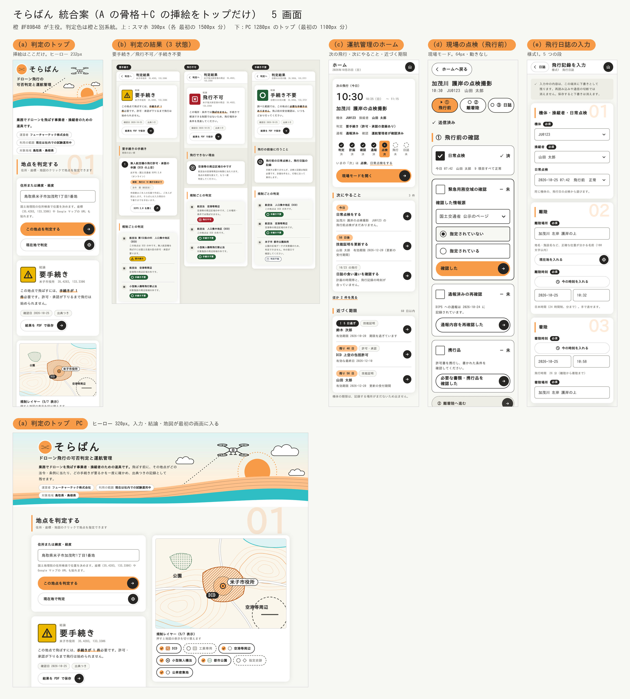

# 統合案（A の骨格＋C の挿絵をトップだけ）

2026-10-25。`docs/design/warm-compare/` の A・B・C から、のりさんが選んだ「A を土台に、C の丘と雲をトップだけに足す」を、5 画面の HTML とスクリーンショットにした。`apps/web` は変更していない。値は `docs/design/tokens-v2/soraban-tokens-v2.css` を各 HTML に埋め込んでいる（外部通信なし）。草案の説明は `docs/design/design-system-v2-draft.md`。



| 画面 | HTML | 画像 |
|---|---|---|
| (a) 判定のトップ（挿絵はここだけ） | `top.html` | `top-mobile.png`（390px）、`top-pc.png`（1280px） |
| (b) 判定の結果（要手続き／飛行不可／手続き不要） | `result.html` | `result-mobile.png`（スマホ 3 枚を横並び） |
| (c) 運航管理のホーム | `home.html` | `home-mobile.png`、`home-pc.png`（左メニュー） |
| (d) 現場の点検（飛行前の確認） | `field.html` | `field-mobile.png` |
| (e) 飛行日誌の入力（様式 1） | `journal.html` | `journal-mobile.png` |

全体を並べた画像は `overview.png`。

## 変更点（warm-compare の A から）

- **ヒーローを低くした**：スマホ 232px、PC 320px（上限 240／320）。C の 400px 級から削り、丘 3 層・雲・日の出・ドローンの独自線画を、結論と入力が最初の画面に入る高さに収めた。会社概要は 1 行のチップにして常に出す。挿絵はトップだけ。
- **結果画面（b）**：A の骨格のまま挿絵なし。要手続き（琥珀△）・飛行不可（赤×。画面の語は実装どおり「飛行不可」）・手続き不要（緑の輪）を並べた。判定色は橙と別系統で、形と言葉を併用。
- **ホーム（c）**：`ops-nav-model.ts`・`today-ui.tsx`・`sprint-12g-1b.md` の項目名に合わせた（次の飛行、行程 7 段、次にやること、近づく期限（機体の期限は出ない旨の 1 行つき）、直近の飛行、免責、下 5 タブ／左メニュー）。期限の札は判定色を使わない。
- **現場の点検（d）**：`ops-field.ts`・`field-client.tsx` の「① 飛行前」の 4 項目（日常点検、緊急用務空域の確認、通報済みの再確認、携行品）。チェック行 64px、主ボタン 64px、動き 0、罫 1.5px、影なし。
- **日誌（e）**：`records-client.tsx` の 5 つの段（機体・操縦者・日常点検／離陸／着陸／飛行概要／安全に影響のあった事項）。
- **遊び心（動きは 2 種類）**：ピルの矢印が入れ替わる（ホバー・押下・フォーカス、0.5s）、結論／次の飛行のカードがせり上がる（1 回、0.6s）。どちらも CSS だけ。`prefers-reduced-motion` と現場（`data-mode="field"`）では動かない（撮影環境で確認：動きを許した場合は 1.2 秒後に不透明度 1、減らす指定では最初から 1、現場は動く要素 0）。

## 確認したこと（`node src/shoot.mjs`）

7 枚の撮影で、はみ出し・12px 未満の文字（現場は 14px）・押せる部品の高さ 44px 未満（現場 56px）・幅 44px 未満が **0 件**。ヒーロー 232／320px。現場のチェック行 64px×4、主ボタン 64px。使われている角丸は 16／8／4／9999px のみ（円を含む）。コントラストは `node ../tokens-v2/check-contrast-v2.mjs` で 0 件失敗。目視で、重なり・潰れ・はみ出しがないことを確認した（日誌の 05 の背後の薄い数字が見出しの末尾にかかるのは装飾で、読みは損なわない）。

## 撮影環境の制約

- Web フォントが無いため、Noto Sans JP・Plus Jakarta Sans の代わりに IPAゴシック（和文）と端末の等幅風の英数字で撮っている。実機とは字の太さ・数字の形が少し違う。折り返し位置も実機で多少ずれうる。
- 下タブと保存バーは、撮影時にビューポートを全高にして末尾に写している。結果画面（b）は 3 枚並べるため、PC 用のレイアウト指定（メディアクエリ）を外した単体のシートで、実画面の PC 表示ではない。
- 暗は未定義（草案の未決 1）。

## 再生成

```
node docs/design/warm-final/src/build.mjs
node docs/design/warm-final/src/shoot.mjs      # 撮影と検査（Chromium は /opt/pw-browsers/chromium-1243）
python3 docs/design/warm-final/src/compose.py  # overview.png
```
